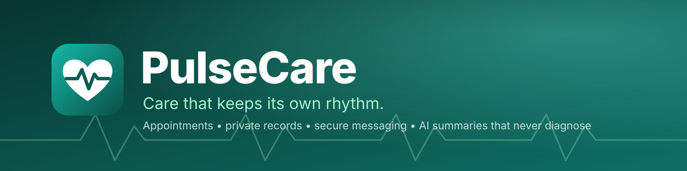
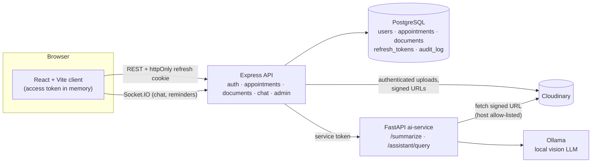

<div align="center">



<br /><br />


# PulseCare

**Care that keeps its own rhythm.**

Book real free slots, share records privately with your doctor, message your care team, and get
plain-language AI summaries of your documents. The AI explains; it never diagnoses.

[](https://github.com/Slv-WebTech/pulsecare/actions/workflows/ci.yml)
[](client/)
[](server/)
[](server/)
[](server/src/models/schema.sql)
[](ai-service/)
[](ai-service/ollama_client.py)
[](server/src/socket/socket.js)
[](docs/TESTING.md)
[](docs/QA-REPORT.md)

[Features](#features) · [Architecture](#architecture) · [Quick start](#quick-start) · [Configuration](#configuration) · [API](#api-overview) · [Testing](#testing) · [Security](#security-and-privacy) · [Roadmap](#roadmap) · [Docs](#documentation)

</div>

---

## Features

<table>
<tr>
<td width="50%" valign="top">

### For patients
- **Find the right doctor**: filter by specialization, location, fee, experience and language, or just *describe* who you need to the AI assistant.
- **Book real free slots**: pick a date, then one of the doctor's actual open times (shown in your time zone). No more guessing.
- **Cancel or reschedule** in two clicks.
- **Private documents**: upload PDF/JPG/PNG, optionally **share with a doctor** for one appointment.
- **AI summaries**: plain-language key points and flagged values from a local vision model, with a clear "not medical advice" disclaimer.
- **Message your care team** in real time, and get **reminders** before visits.

</td>
<td width="50%" valign="top">

### For doctors and admins
- **Dashboard** of today's, upcoming, completed and cancelled appointments; move visits through their lifecycle.
- **View documents** a patient chose to share with you, through short-lived signed links.
- **Per-doctor time zone** and weekly availability; daylight saving handled.
- **Secure chat** with patients you actually treat.
- **Admin overview**: patients, doctors, appointments, completion rate, popular specializations.
- **Audit log** of who accessed what (`GET /api/admin/audit`).

</td>
</tr>
</table>

<table>
<tr>
<td align="center" width="25%"><b>Race-proof booking</b><br />A Postgres exclusion constraint makes double-booking impossible, even under concurrent requests.</td>
<td align="center" width="25%"><b>Private by default</b><br />Documents are unreachable by URL; every access is checked and audited.</td>
<td align="center" width="25%"><b>Revocable sessions</b><br />15-minute in-memory token plus a rotating httpOnly refresh cookie.</td>
<td align="center" width="25%"><b>AI that stays in its lane</b><br />Local Ollama model, structured output, no diagnosis, long-PDF truncation is disclosed.</td>
</tr>
</table>

> **Screenshots:** none are committed yet, so no patient-like data ever ends up in the repository. Run the app locally
> ([Quick start](#quick-start)) with the sample accounts you create to see it. PRs adding scrubbed screenshots are welcome in `docs/assets/`.

## Architecture



```mermaid
sequenceDiagram
  autonumber
  participant P as Patient (browser)
  participant API as Express API
  participant DB as PostgreSQL
  P->>API: GET /doctors/:id/slots?date=YYYY-MM-DD
  API->>DB: availability windows + booked ranges
  API-->>P: free slots (doctor's time zone)
  P->>API: POST /appointments {startsAt, endsAt}
  API->>DB: INSERT (exclusion constraint guards overlaps)
  DB-->>API: ok / conflict
  API-->>P: 201, or 409 "slot already booked"
  Note over API,DB: reminder row created; worker pushes it 24h before
```

```
pulsecare/
├── client/       React + Vite app (patient / doctor / admin dashboards, design system)
├── server/       Express API, Socket.IO, reminder worker, SQL schema + migrations, tests
├── ai-service/   FastAPI service: document summaries and natural-language doctor search (Ollama)
├── assets/       Logo, banner, favicon and social-preview artwork (+ generator script)
├── docs/         Architecture, API, database, testing, QA report, changelog, decisions
└── .github/      CI workflow, PR and issue templates
```

## Quick start

**Prerequisites:** Node 18+, PostgreSQL 14+ (with the bundled `btree_gist` and `pg_trgm` extensions), Python 3.11+.
For AI features: [Ollama](https://ollama.com) with a vision model. For document upload: a [Cloudinary](https://cloudinary.com) account.

```bash
# 1. Database
createdb pulsecare
psql -d pulsecare -v ON_ERROR_STOP=1 -f server/src/models/schema.sql

# 2. Server (http://localhost:5000)
cd server && cp .env.example .env     # set DATABASE_URL, JWT_SECRET, CLOUDINARY_*, AI_SERVICE_TOKEN
npm install && npm run dev

# 3. Client (http://localhost:5173)
cd client && cp .env.example .env
npm install && npm run dev

# 4. AI service (http://localhost:8000), optional
ollama pull llama3.2-vision
cd ai-service && cp .env.example .env     # AI_SERVICE_TOKEN must match the server's
python -m venv .venv && . .venv/bin/activate   # Windows: .venv\Scripts\activate
pip install -r requirements.txt
uvicorn main:app --reload --port 8000
```

- The server refuses to start without a real `JWT_SECRET` (not unset, not `change-me`).
- Register a patient and a doctor in the UI. Doctors set a profile with `PUT /api/doctors/profile`; weekly availability rows live in
  `doctor_availability` (no UI yet, seed them with SQL).
- Admins are created directly in the database; there is no public admin sign-up.
- Upgrading an existing database? Apply `server/src/models/migrations_001_*.sql`, then `migrations_002_*.sql` (re-runnable), and expect users to log in again.

## Configuration

| Service | Variable | Purpose |
|---|---|---|
| server | `DATABASE_URL` | Postgres connection string |
| server | `JWT_SECRET` | Signs access tokens (required, must not be `change-me`) |
| server | `JWT_EXPIRES_IN` | Access-token lifetime, default `15m` |
| server | `CLIENT_ORIGIN` | Exact front-end origin (CORS and refresh-cookie origin check) |
| server | `CLOUDINARY_CLOUD_NAME` / `_API_KEY` / `_API_SECRET` | Private document storage |
| server | `AI_SERVICE_URL` / `AI_SERVICE_TOKEN` | Where the ai-service lives and the shared bearer token |
| server | `DEFAULT_TIMEZONE`, `MAX_ACTIVE_APPOINTMENTS` | Fallback doctor time zone; per-patient upcoming-appointment cap (default 10) |
| server | `AUTH_RATE_LIMIT`, `REFRESH_RATE_LIMIT`, `API_RATE_LIMIT` | Rate limits (defaults 20 / 120 per 15 min, 300 per min) |
| server | `NODE_ENV=production` | Makes the refresh cookie `Secure` (HTTPS only) |
| client | `VITE_API_URL`, `VITE_SOCKET_URL` | API and Socket.IO base URLs |
| ai-service | `OLLAMA_BASE_URL`, `OLLAMA_MODEL` | Local model endpoint and model name |
| ai-service | `AI_SERVICE_TOKEN`, `CLIENT_ORIGIN`, `SERVER_ORIGIN` | Shared secret and allowed origins |

Only `*.env.example` files with placeholder values are tracked; every real `.env*` file is git-ignored.

## API overview

All routes are under `/api` and need `Authorization: Bearer <access token>` unless noted. Full reference: [`docs/API_DOCUMENTATION.md`](docs/API_DOCUMENTATION.md).

| Area | Endpoints |
|---|---|
| Auth | `POST /auth/register` · `POST /auth/login` · `POST /auth/refresh` (cookie) · `POST /auth/logout` · `GET /auth/me` |
| Doctors | `GET /doctors` (public, paginated) · `GET /doctors/:id/slots?date=` · `GET /doctors/:id/availability` · `PUT /doctors/profile` (doctor) |
| Appointments | `POST /appointments` (patient) · `GET /appointments` · `PATCH /appointments/:id/status` · `PATCH /appointments/:id/reschedule` |
| Documents | `POST /documents` · `GET /documents` · `GET /documents/:id/file` (signed URL) · `GET /documents/patient/:patientId` (doctor) · `POST /documents/:id/summarize` |
| Assistant | `POST /assistant/query` |
| Chat | `GET /chat/:userId` · `PATCH /chat/:id/read` · Socket.IO `message:send`, `typing`, `reminder:due` |
| Admin | `GET /admin/stats` · `GET /admin/audit` |

## Testing

```bash
cd server    && npm test                  # 14 unit tests (no database needed)
cd ai-service && pytest -q                # 39 tests: endpoints with Ollama and Cloudinary mocked
cd client    && npm test                  # 21 Vitest tests: session refresh, booking, cancel/reschedule, assistant
```

26 **live API tests** exercise the real server against a throwaway Postgres, with a fake Cloudinary and ai-service
(uploads, signed delivery, summaries, sessions, reminders, concurrency, isolation). See the header of
[`server/tests/integration/api.live.test.js`](server/tests/integration/api.live.test.js). A load-test script lives in
`server/tests/load/`. GitHub Actions runs everything on every push ([`ci.yml`](.github/workflows/ci.yml)).
Details and the latest QA findings: [`docs/TESTING.md`](docs/TESTING.md), [`docs/QA-REPORT.md`](docs/QA-REPORT.md).

## Security and privacy

- **Sessions:** short-lived access token held in memory; rotating, hashed, revocable refresh token in an `HttpOnly; SameSite=Lax` cookie; replay of an old token revokes the whole session. Nothing sensitive in `localStorage`.
- **Documents:** stored as Cloudinary *authenticated* assets; the API never returns storage URLs. A signed URL is issued only to the owner or to a doctor the patient shared the document with. Every access is audited.
- **Access control:** role checks on every route; chat requires a care relationship; patients can only cancel; ids are validated.
- **Hardening:** CSP and security headers, rate limits, body size cap, parameterized SQL, SSRF allow-list in the AI service, strict CSP in the production client build.
- **AI:** summaries run on a *local* model, are labelled as informational, and disclose when a long PDF was only partly read.
- **Known limits:** an issued access token stays valid for up to 15 minutes after logout; signed Cloudinary URLs only expire on plans with token authentication; reminders are in-app only (no email/SMS provider); no screen-reader or cross-browser audit yet. Full list in [`docs/QA-REPORT.md`](docs/QA-REPORT.md).

> PulseCare is not certified for production handling of regulated health data. Do your own HIPAA/GDPR review, add a BAA with
> your storage provider, and run a penetration test before real use.

## Roadmap

- [x] Slot-based booking, cancel/reschedule, in-app reminders
- [x] Private documents with doctor sharing and audit trail
- [x] AI document summaries and assistant search
- [ ] Email / SMS reminders (needs a provider; the worker has a single `deliver()` seam)
- [ ] UI for doctors to manage their weekly availability and timezone
- [ ] Audit-log viewer in the admin dashboard
- [ ] Calendar sync (ICS / Google), digital prescriptions, PWA support
- [ ] Cross-browser and assistive-technology test pass

## Documentation

Start at [`docs/README.md`](docs/README.md). Highlights: [architecture](docs/ARCHITECTURE.md), [API](docs/API_DOCUMENTATION.md),
[database](docs/DATABASE.md), [decisions](docs/DECISIONS.md), [changelog](docs/CHANGELOG.md), [QA report](docs/QA-REPORT.md).
Contributions: see [`.github/PULL_REQUEST_TEMPLATE.md`](.github/PULL_REQUEST_TEMPLATE.md).

## License

No license has been chosen yet, so all rights are reserved by the repository owner until a `LICENSE` file is added.
